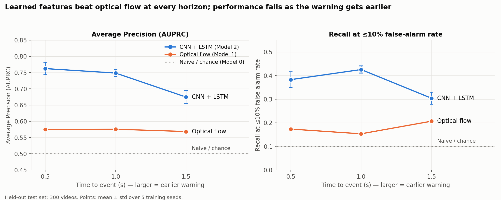
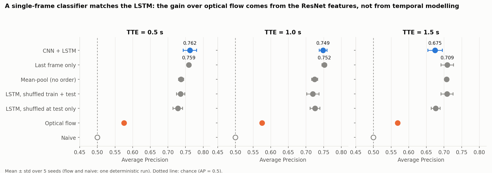
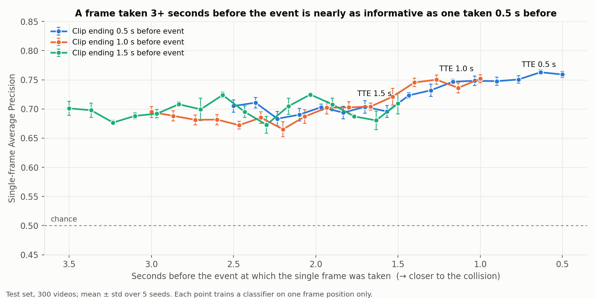

# Anticipating Dashcam Collisions

**Can a model see a collision coming from dashcam video — and does learned temporal modelling beat simple motion cues?**
A controlled comparison on the [Nexar](https://huggingface.co/datasets/nexar-ai/nexar_collision_prediction) dashcam collision dataset, at 0.5, 1.0 and 1.5 seconds before the annotated event.

COMS4036A Computer Vision, University of the Witwatersrand · Muhammad Hoosen (2552770) · Rameez Atif (2612521)

**Quick links:** [Report (PDF)](report/main.pdf) · [Experiment log](EXPERIMENT_LOG.md) · [Notebook guide](notebooks/README.md) · [Original design document](docs/PROJECT_DESIGN.md)

---

## Overview

We compare three models under one protocol (same video-level split, same clips, same metric):

| Model | Description |
|---|---|
| **0 — Naive** | Predicts "collision" for every clip (the AP floor). |
| **1 — Optical flow** | Farnebäck flow between sampled frames → 21 motion statistics → logistic regression. |
| **2 — CNN + LSTM** | Frozen ImageNet ResNet-18 features for 16 frames → one-layer LSTM → collision probability. |

Controls on the same features (last frame only, mean-pooling, shuffled frame order) test whether *temporal* modelling is what helps.

## Results at a glance

Average precision (AP) on the 300 held-out test videos; mean ± std over 5 training seeds. Chance = 0.5.

| Model | 0.5 s | 1.0 s | 1.5 s |
|---|---:|---:|---:|
| Naive | 0.500 | 0.500 | 0.500 |
| Optical flow | 0.575 | 0.576 | 0.569 |
| **CNN + LSTM** | **0.762 ± 0.019** | **0.749 ± 0.011** | **0.675 ± 0.021** |
| *Control: last frame only* | *0.759 ± 0.005* | *0.752 ± 0.007* | *0.709 ± 0.018* |



**What we found**

- **Learned features beat motion cues** at every horizon (AP +0.197 / +0.180 / +0.117; all paired 95% bootstrap CIs exclude zero).
- **Temporal modelling is not demonstrated.** A single frame does as well as the LSTM, as do mean-pooling and an LSTM trained on shuffled frames — the gain comes from the pretrained visual features.
- **Performance falls with horizon**, but only the 0.5 s → 1.5 s drop (0.086 AP, 95% CI 0.03–0.14) is distinguishable from zero. The proposal's hypothesis (the learned model degrades *more slowly* than optical flow) is **not supported**.
- **Much of the signal is present long before the event** (a single frame from 3+ s before it already gives AP ≈ 0.70), so we describe the model as recognising high-risk scenes rather than detecting imminent collisions.





## Quick start

Tested from a fresh `git clone` on Windows 10 with Python 3.10 (CPU only; no GPU needed).

```bash
git clone https://github.com/RameezAtif/nexar-collision-prediction.git
cd nexar-collision-prediction
python -m venv .venv
source .venv/bin/activate          # Windows: .venv\Scripts\activate
pip install -r requirements.txt

python tools/run_notebooks.py      # reproduces all results (notebooks 06–09), about 5 minutes
```

No raw videos are needed for this: the split, clip definitions and cached features are committed in `data/processed/`.

## Commands

| Command | What it does | Needs raw data |
|---|---|:---:|
| `python tools/run_notebooks.py` | Runs notebooks 06–09 and rewrites the files in `results/` | no |
| `python tools/make_report_assets.py` | Builds the report's figures and tables from `results/*.csv` | no |
| `cd report && sh build.sh` | Builds `report/main.pdf` with Docker (or compile `report/main.tex` with any LaTeX) | no |
| `python tools/run_notebooks.py 03_clip_sampling 04_baselines 05_learned_temporal_model` | Regenerates the splits, flow features and ResNet features (slow: hours on a CPU) | yes |
| `python tools/compare_id_blocks.py --available-only` | Raw-video comparison of the two video-id blocks | yes |
| `python tools/fulldata_selection_check.py` | Quantifies the cost of choosing the epoch on the test videos | no |
| `python tools/run_notebooks.py --list` | Lists the notebooks and what each needs | no |

## Repository layout

```text
.
├── README.md
├── EXPERIMENT_LOG.md        every experiment, decision and open item
├── requirements.txt
├── 200notok_proposal.tex    project proposal
├── data/processed/          splits, clip definitions, cached ResNet and optical-flow features (committed)
├── notebooks/               01–09: exploration → baselines → CNN+LSTM → ablation → analysis (see notebooks/README.md)
├── tools/                   run_notebooks.py, make_report_assets.py, compare_id_blocks.py, fulldata_selection_check.py
├── results/                 result CSVs and figures/
├── report/                  IEEE-format report: main.tex, main.pdf, figures/, tables/
├── slides/                  scripts and Q&A notes for the presentation
└── docs/PROJECT_DESIGN.md   original long-form design document
```

## Experimental protocol

- **Split:** 1,200 training / 300 test videos, stratified 50/50, made at video level *before* any clip is cut (seed 42, zero overlap checked).
- **Clips:** for a collision video with event time *t*ₑ and a chosen TTE, the input is 16 frames sampled evenly from the 2 s ending at *t*ₑ − TTE (no frame after that time). Normal videos get a prediction time drawn once from the collision distribution.
- **Training:** Adam, lr 1e-3, batch 32, 10 epochs; epoch chosen on 20% of the *training* videos, never on the test videos; 5 seeds.
- **Metrics:** average precision (primary); recall at ≤ 10% false-alarm rate; ROC-AUC, precision, recall, F1 in the CSVs. Uncertainty: seed std plus a paired bootstrap over the 300 test clips (2,000 resamples).

## Reproducibility

- **Seeds:** 42 for the split and sampling; 42–46 for training; fixed seeds for bootstrap and permutation tests.
- **Verified:** a fresh clone with no raw data regenerated all 24 result CSVs identically (difference < 1e-9) on the same machine. Across operating systems and library versions expect small numerical differences (for example ≤ 0.0007 AP for the scaled optical-flow baseline).

### Where each reported number comes from

| Report item | File | Produced by |
|---|---|---|
| Main results (AP, recall at fixed false-alarm rate), mean ± std over 5 seeds | `results/temporal_ablation_summary.csv` | notebook 06 |
| Paired bootstrap confidence intervals | `results/temporal_ablation_bootstrap.csv` | notebook 06 |
| Single-frame AP by frame position; annotated-alert timing | `results/failure_frame_position_ap.csv`, `results/failure_alert_timing.csv` | notebook 08 |
| Video-id block tests | `results/id_block_test_*.csv`, `results/id_blocks/*.csv` | notebook 09, `tools/compare_id_blocks.py` |
| Selection-optimism check | `results/selection_check_fulldata.csv` | `tools/fulldata_selection_check.py` |
| Report tables and figures | `report/tables/*.tex`, `report/figures/*.pdf` | `tools/make_report_assets.py` |

## Limitations

- **Video-id blocks.** Every collision video has id ≤ 1039 and every normal video id ≥ 1040. No model uses the id, but the blocks might differ in recording conditions. On a 431-video sample we found no difference in resolution, frame rate, duration, brightness or overlay; scene content was not tested.
- **No separate untouched test set** (the 300 held-out videos informed earlier choices), and only 300 clips, so an AP has a 95% interval of about ±0.07.
- **One frozen backbone and one clip design;** the optical-flow baseline uses frames about 0.13 s apart, so classical cues may be underestimated.
- **Earlier numbers.** Notebook 05 and `results/final_analysis/` pick the best epoch on the test videos and are optimistic by about 0.04–0.07 AP; they are kept for reference only (see `EXPERIMENT_LOG.md`).

## Data

The raw Nexar videos (about 31 GB; 25.5 GB of training videos) are **not** in this repository. Only notebooks 01–05 and `tools/compare_id_blocks.py` need them.
Accept the rules of the [Kaggle competition](https://www.kaggle.com/competitions/nexar-collision-prediction/data) or use the [Hugging Face dataset](https://huggingface.co/datasets/nexar-ai/nexar_collision_prediction),
then place `train.csv` and the `train/` folder under `data/raw/`.

### Data attribution and licence

This project uses the **Nexar Dashcam Collision Prediction Dataset**: D. C. Moura, S. Zhu and O. Zvitia, "Nexar Dashcam Collision Prediction Dataset and Challenge," *CVPR Workshops*, 2025, pp. 2608–2616 (Nexar Inc.).
The Nexar open data licence permits free use, copying and redistribution **with attribution to Nexar Inc. and the copyright notice retained**, and prohibits resale, re-identification of people or vehicles, weapons use, and systems intended to cause harm
([licence text](https://huggingface.co/datasets/nexar-ai/nexar_collision_prediction/blob/main/LICENSE)).
This repository holds derived data only (labels, event times, clip windows, features) and a few small example-frame contact sheets in `results/id_blocks/`, with this attribution. It contains no raw videos.
